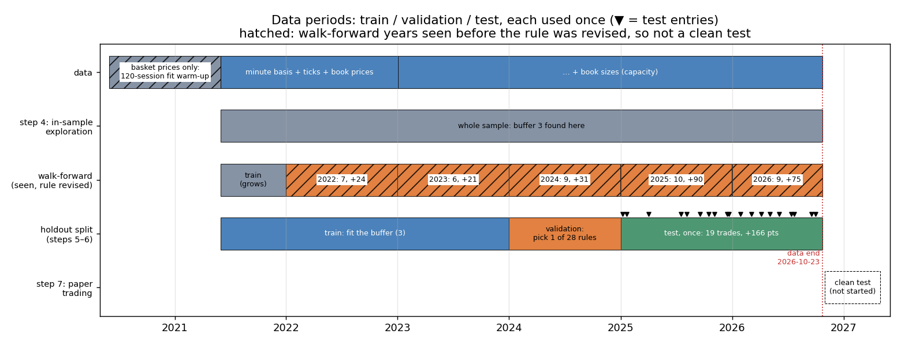
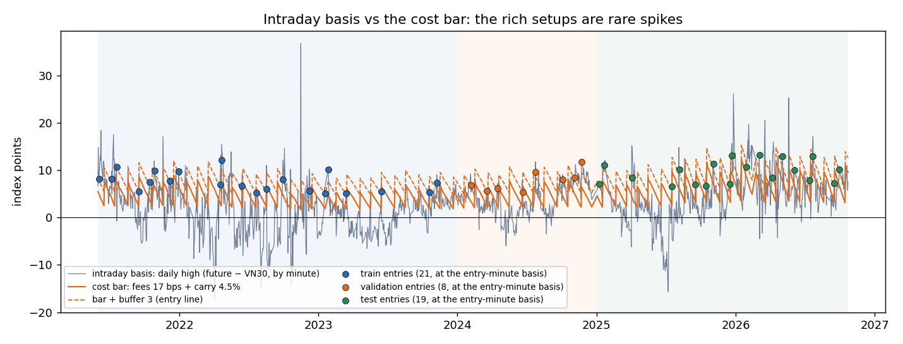
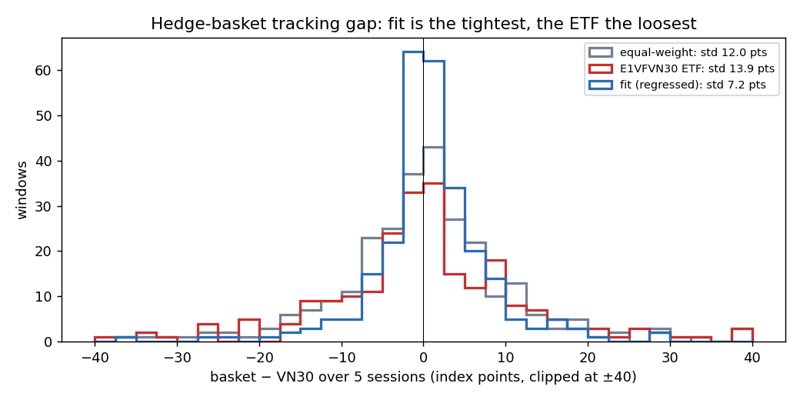
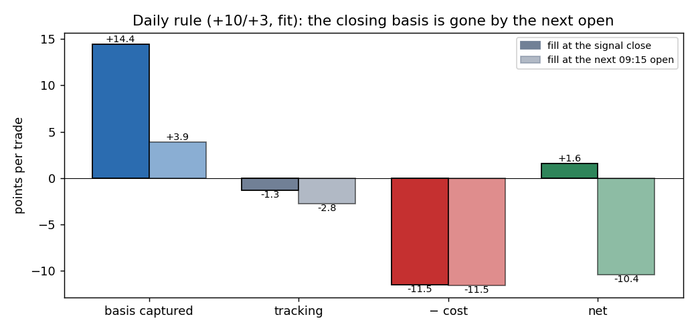
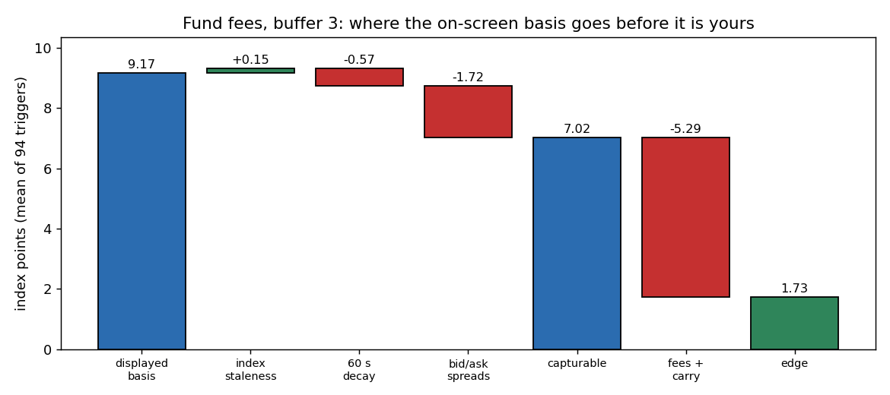
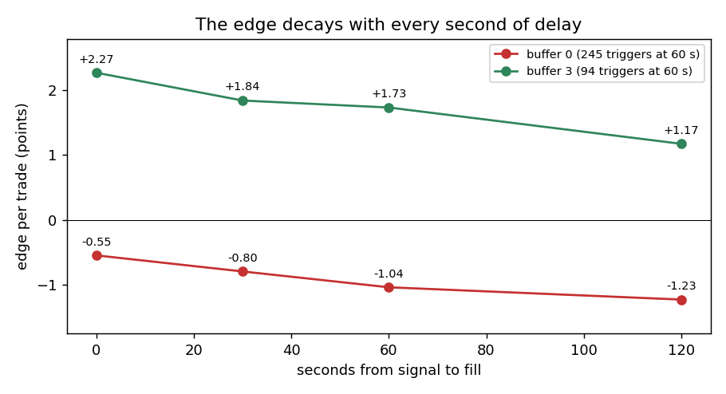
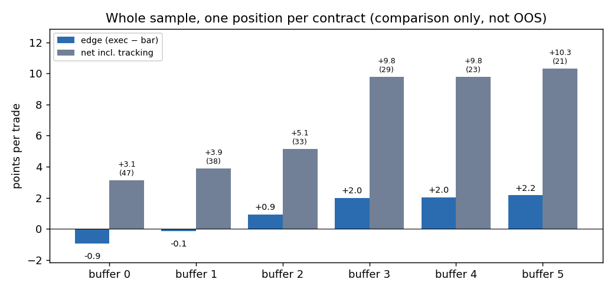
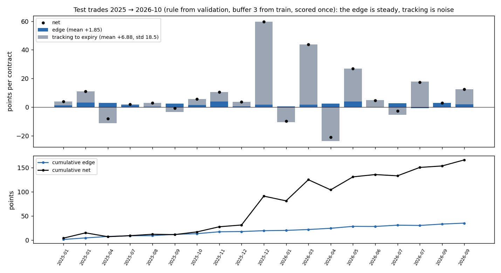
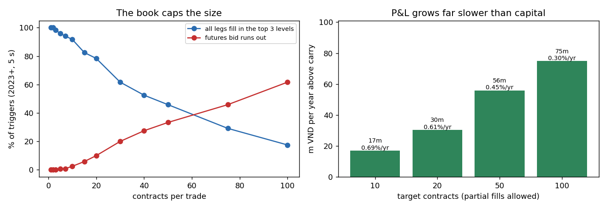

# Cash-and-Carry Arbitrage — long VN30 basket / short VN30F1M (basis convergence)

It tests a **cash-and-carry basis trade**: when the VN30 front-month future
(`VN30F1M`) trades rich versus the VN30 index, buy a basket of stocks that tracks VN30
and short the future, then hold until expiry, when the basis is forced to zero.

## Data periods



| period | dates | used for |
|---|---|---|
| warm-up | 2020-06 → 2021-05 | basket prices only: the first 120-session fit of the hedge basket |
| **train** | 2021-06-01 → 2023-12-31 | fit the buffer for each candidate rule |
| **validation** | 2024-01-01 → 2024-12-31 | choose one of 28 candidate rules, automatically |
| **test** | 2025-01-01 → 2026-10-23 | the chosen rule, scored once: 19 trades, +166 pts |
| clean test | from 2026-11 (step 7, not started) | paper trading |

Each period is used once, in that order, and the protocol (periods, candidate rules,
selection) is fixed in `scripts/holdout_split.py` before it runs. A trade counts in a
period only if it also expires inside it, so no outcome crosses a boundary. The earlier
anchored walk-forward (hatched) scored 2022–2026 out of sample, but the entry rule was
revised after those results were seen, so it is not a clean test; see
[6e](#6e-train--validation--test-split-scriptsholdout_splitpy). The analyst had seen
these years before the split too, so only paper trading is untouched.

## TL;DR

| question | answer |
|---|---|
| Does the basis converge? | Yes, by construction: the future settles at the VN30 close on expiry day. |
| Is the daily-close version tradeable? | **No.** It only made money when it filled at the same close that produced the signal. At the next 09:15 open the captured basis falls from 14.4 to 3.9 pts, and walk-forward OOS is −94 pts. |
| Is the intraday version tradeable? | **At fund costs, yes, but it is small.** Adopted rule: 17 bps fees, 4.5% carry, a 3-pt buffer, a 5 s fill, entries allowed up to expiry day. Out of sample (2022–2026, 41 trades) the edge is **+2.05 pts/trade (t 10.6, 93% positive)**, net +5.89 (t 2.84). Buffer 3 is picked in every walk-forward fold. On a train / validation / test split (test 2025–2026, scored once) the edge is +1.85 (t 6.1) over 19 trades. At retail fees (40 bps) it loses. |
| How big? | The futures bid caps it at ~10–30 contracts per trade, and the rule trades ~8–9 times a year. At 10 contracts: **≈ 17m VND/yr on ≈ 2.5bn (≈ 0.7%/yr above carry)**; ≈ 75m on 25bn (0.3%) at 100. |
| Biggest risk | The hedge basket drifting from VN30 until expiry: ±13 pts std per trade, ~6× the edge. It was positive in the sample (+3.8/trade), but that came from a few names (VHM, VCB, PLX), so it is treated as luck. Entries in the last week barely drift (±0.2 on average). |
| Verdict | A real but tiny, capacity-bound edge. Not worth running as a standalone strategy. Step 7 (paper trading) only makes sense with the **official VN30 weights** for the basket. |

## The intuition in one paragraph

A future is a promise to trade VN30 at a set price on expiry day. Its fair price is the
index plus **carry**: the buyer of the future does not have to put up cash, while the
buyer of the stocks does, so the future is allowed to cost VN30 × rate × days/365 more.
When speculators push the future further above that, you can sell the expensive future
and buy the cheap stocks. Market moves cancel out across the two legs. On expiry day the
future settles at the VN30 close, and you sell the stocks in the closing auction at the
same prices, so the gap you locked in becomes cash. What eats it: bid/ask spreads,
the gap closing before you are filled, fees and the 0.1% sell tax, the deposit interest
the capital gives up, and the basket not moving exactly like the index.

## Glossary

| term | meaning |
|---|---|
| basis | future − VN30, in index points (1 pt = 100,000 VND per contract) |
| bar | the break-even basis: VN30 × (round-trip fees + rate × days-to-expiry/365) |
| buffer | extra points demanded above the bar before entering (the only tuned parameter) |
| displayed basis | last future trade − last VN30 print, what the screen shows |
| capturable / exec | futures best bid − basket bought at each stock's best ask, what you actually lock |
| edge | exec − bar: the profit known at entry |
| tracking | basket return − VN30 return until expiry: the unintended part of the P&L |
| net | futures P&L + basket P&L − fees − carry, in points per contract |

---

## Nine-step map

| step | section below | script → output | status |
|---|---|---|---|
| 1 Hypothesis | [Step 1](#step-1--hypothesis) | — | done |
| 2 Data collection | [Step 2](#step-2--data-collection) | `sql/*.sql`, `download_data.py` → `data/raw/` | done |
| 3 Data processing | [Step 3](#step-3--data-processing-the-hedge-basket) | `tracking_error.py` → `result/tracking/` | done; official weights missing |
| 4 In-sample backtest | [Step 4](#step-4--in-sample-backtest) | `basis_backtest.py`, `intraday_check.py` → `result/basis*/`, `result/intraday*/` | done |
| 5 Optimization | [Step 5](#step-5--optimization) | `walk_forward.py`, `walk_forward_intraday.py` | done: one parameter (buffer) |
| 6 Out-of-sample | [Step 6](#step-6--out-of-sample) | `walk_forward_intraday.py`, `holdout_split.py`, `capacity.py` → `result/walkforward_intraday*/`, `result/holdout_split/`, `result/capacity_5s/` | done: positive, capacity-bound |
| 7 Paper trading | [Step 7](#steps-79--not-started) | — | not started |
| 8–9 Live trading onward | [Steps 8–9](#steps-79--not-started) | — | not started |

---

## Step 1 — Hypothesis

> VN30F1M periodically trades above the VN30 index by more than fees + carry. Buying a
> VN30-tracking basket and shorting the future at that moment locks the excess, which is
> paid out at expiry when the future settles at the index. The trade is market-neutral
> apart from the basket's tracking error.

Why the basis could overshoot: retail flows push the future up in euphoric moments, and
arbitrage needs capital plus the ability to buy ~30 stocks at once, so few players
close the gap. What could break it: the gap may close faster than you can trade, and the
basket may not track the index.

## Step 2 — Data collection

All from `algotradeDB` (credentials in a gitignored `.env`).

| file | query | content |
|---|---|---|
| `data/raw/vn30f_frontmonth.parquet` | `sql/vn30f_frontmonth.sql` | front-month contract per day (spliced via `VN30F1M`), close, OI, VN30 close and 09:15 open, the future's first trade ≥ 09:15, expiry |
| `data/raw/vn30_membership.parquet` | `sql/vn30_membership.sql` | VN30 constituent snapshots (no survivorship bias) |
| `data/raw/vn30_basket_prices.parquet` | `sql/basket_prices.sql` | adjusted (total-return) and raw close, adjusted open, volume for every name ever in VN30, plus `VN30` and the `E1VFVN30` ETF, from 2020-06 |
| `data/raw/intraday_basis_minute.parquet` | `sql/intraday_basis_minute.sql` | last futures trade and last VN30 print per minute, 2021-06 → 2026-10 |
| (queried per event) | `quote.matched`, `quote.askprice/bidprice`, `quote.asksize/bidsize` | ticks and the top-3 book of every basket name and the contract |

Data facts that shaped the design:
- The future's daily `open` is the 08:45 pre-open print, taken while the index is still at
  yesterday's close. The query pulls the first trade at or after 09:15 instead.
- Book **sizes** exist only from 2023-01-03, so size and capacity tests start there.
- `financial.info` has no shares outstanding for banks, brokers or insurers, and there is
  no free-float data, so **the official VN30 weights cannot be rebuilt** from this DB.
- The futures settlement column is empty; settlement uses the VN30 close on expiry day.



*Daily closing basis since 2021-06. The future usually trades at a **discount** (median
−1.3 pts); only ~2% of days close at +8 or more. The orange line is the fund-cost bar (17
bps + 4.5% carry), which saw-tooths down into each expiry as carry runs off. The dashed
line is the entry line (bar + 3). Green dots are the 41 out-of-sample intraday entries of the adopted rule (each contract's first trigger, at its intraday basis).*

## Step 3 — Data processing: the hedge basket

The basket decides how much of the P&L is the basis and how much is an accidental bet.
Three baskets, rebuilt from the members on each date:

| basket | construction |
|---|---|
| equal | 1/30 per member |
| **fit** | long-only weights regressed on VN30 over the trailing 120 sessions, soft sum-to-one (NNLS, λ = 100) |
| etf | hold E1VFVN30 |

`scripts/tracking_error.py`: basket − VN30 over 269 non-overlapping 5-session windows.

| basket | mean gap | std | 5%–95% | share \|gap\| > 10 pts |
|---|---|---|---|---|
| equal | +0.49 | 12.0 | −16.6 … +17.7 | 26% |
| **fit** | +0.96 | **7.2** | −9.9 … +12.7 | **12%** |
| ETF | +0.44 | 13.9 | −21.1 … +21.6 | 32% |



- The mean gap is ≈ 0 for all three, so the equal-weight "small caps beat large caps"
  tilt is noise, not an edge. Remove it.
- **fit is used from here on.** It cuts the gap by ~40%.
- The ETF is the worst hedge: its price runs away from the index on volatile days
  (e.g. 2026-04-08: VN30 +4.9%, ETF +6.9%), which are exactly the days the basis spikes.
- Still missing: the **official HOSE weights**. A desk replicating them would track to
  ~1–3 pts instead of ~7.

## Step 4 — In-sample backtest

### 4a. Daily rule (`scripts/basis_backtest.py`)

Enter when the closing basis ≥ +10, exit at ≤ +3 or expiry; 70 bps round trip (fees, tax,
slippage); T+2; daily margin simulation with a cash reserve. 12 trades, 2021-06 → 2026-10.
Gross P&L splits exactly into **basis captured** (entry − exit basis) and **tracking**:

| basket | avg basis | avg tracking | tracking std | avg cost | avg net |
|---|---|---|---|---|---|
| equal | +14.38 | −6.38 | 14.18 | 11.51 | −3.50 |
| **fit** | +14.38 | −1.30 | 6.01 | 11.51 | **+1.57** |
| ETF | +14.38 | −5.00 | 16.63 | 11.51 | −2.13 |

The basis converged on 12/12 trades. But every fill is **at the close that produced the
signal**, which cannot be done. Filling at the next 09:15 open instead (stocks at their
ATO, future at its first trade ≥ 09:15):



The captured basis drops from **14.4 to 3.9 pts** and the net from +1.6 to **−10.4**. A rich
closing basis is a closing-print dislocation that reverts overnight
(e.g. VN30F2604: +13.96 at the signal close, −14.42 at the next 09:15).

### 4b. Intraday rule (`scripts/intraday_check.py`)

If the dislocation lasts minutes, not hours, the test must be intraday:

1. every minute of continuous trading (09:16–11:29, 13:00–14:29), displayed basis and bar;
2. a trigger is the first minute of a day with **displayed − bar ≥ buffer**, up to expiry day
   (the first run required ≥ 7 days to expiry; see 6c);
3. after a delay, fill at the real book: **sell the future at its best bid, buy each
   stock at its best ask** (quotes must be two-sided, uncrossed, within 3% of the last
   trade; ≥ 90% of basket weight quotable; the fill must land in continuous trading);
4. hold to expiry, so the basis settles to 0.

The bar now includes **carry**, which the daily backtest ignored. Where the displayed
basis goes, at fund fees, buffer 3, 5 s:



Spreads cost ~1.8 pts; 5 s of delay costs almost nothing (−0.07; 60 s would cost ~0.5), and
the VN30 print is not stale on average. About **1.8 pts** of the on-screen basis is never
yours, which is why the buffer has to exceed ~2.

Every trigger day, entries up to expiry day (`result/intraday_fund_buffer{0,3}_expiry/`):

| fees | buffer | triggers | edge @ 5 s | t | edge > 0 | edge @ 60 s |
|---|---|---|---|---|---|---|
| 17 bps (fund, assumed) | 0 | 448 | −0.70 | −8.6 | 22% | −1.05 |
| 17 bps (fund, assumed) | 3 | 181 | **+2.18** | +19.0 | 96% | +1.73 |

First run at retail fees (≥ 7 days to expiry, 60 s): buffer 0 −1.73 (t −5.9, 86 triggers),
buffer 5 +2.69 (t +2.6, 9 triggers).



Fees: retail = 12 + 12 bps brokerage, 10 bps sell tax, 3 + 3 bps futures. Fund = ~3 + 3
brokerage, the same 10 bps tax, ~1 futures. **The fund figures are assumptions**, not a
quoted fee schedule. Buffer 3 here was chosen after seeing buffer 0, which is why
steps 5–6 exist.

## Step 5 — Optimization

### 5a. Daily rule (`scripts/walk_forward.py`)

Anchored yearly walk-forward over entry {6…14} × exit {0,3,5} × basket. OOS −54.5 pts
(all baskets), −73.3 (fit only). Root cause: a threshold in fixed points while costs scale
with the index (8–9 pts in 2024, 13–14 in 2026). With a cost-relative entry the OOS is
+7.1 pts at close fills but **−94.4 pts (t −3.5)** at next-open fills. The daily rule is
dead.

### 5b. Intraday rule (`scripts/walk_forward_intraday.py`)

| | value |
|---|---|
| **tuned** | buffer ∈ {0,1,2,3,4,5} × volatility cap ∈ {none, 25%, 20%} (trailing 20-session VN30 vol, annualised, known before the day) |
| fixed in advance | fit window 120 sessions, fees 17 bps, carry 4.5%, 1 contract, **one position per contract** (its first trigger), signals 09:16–11:29 and 13:00–14:29 |
| fixed, then revised after the first OOS run (see 6c) | fill delay 60 s → **5 s** (30 s and 60 s kept as variants); ≥ 7 days to expiry → **entries up to expiry day** |
| pick rule | highest total net over all years before the test year, ≥ 3 trades |
| folds | test 2022, 2023, 2024, 2025, 2026 (to 2026-10-23); train from 2021-06 |

Whole-sample view (not out of sample, shown for intuition):



The edge turns positive from buffer 2 and flattens from 3; fewer trades as the buffer rises.

## Step 6 — Out-of-sample

### 6a. Full lifecycle of each trade

Each trade is simulated end to end: entry at the real book after the delay, a daily mark
of the short future (margin top-up), and at expiry the future settles at the VN30 close
while the basket is sold at each name's close, with dividends via adjusted/raw closes.

**Worked example (2024-09-26, VN30F2410, 5 s fill):**

| | points |
|---|---|
| VN30 at the 14:17 signal | 1,354.92 |
| displayed basis | 9.08 |
| bar = 1,354.92 × (0.17% + 4.5% × 21/365) = 2.30 fees + 3.51 carry | 5.81 |
| future sold at the bid / basket bought at the asks (index-equivalent) | 1,363.60 / 1,356.00 |
| exec (capturable) / edge = exec − bar | 7.60 / **+1.79** |
| VN30 close on expiry day 2024-10-17 | 1,362.89 |
| futures leg (1,363.60 − 1,362.89) / basket leg (closes + dividends) | +0.71 / +10.91 |
| cash = 11.62 − 2.30 fees | +9.32 (932k VND) |
| **net** = cash − 3.51 carry | **+5.81** |
| of which edge / tracking | +1.79 / +4.03 |
| worst margin top-up during the hold | 3.0 |

### 6b. Walk-forward result (adopted rule: 5 s fill, entries up to expiry day)

| test year | pick | trades | total net | mean | edge | tracking |
|---|---|---|---|---|---|---|
| 2022 | buffer 3, no filter | 7 | +24.0 | +3.42 | +2.23 | +1.19 |
| 2023 | buffer 3, no filter | 6 | +21.1 | +3.51 | +2.29 | +1.22 |
| 2024 | buffer 3, no filter | 9 | +31.3 | +3.48 | +2.25 | +1.23 |
| 2025 | buffer 3, no filter | 10 | +90.3 | +9.03 | +1.90 | +7.13 |
| 2026 | buffer 3, no filter | 9 | +74.9 | +8.33 | +1.74 | +6.59 |

**Stitched OOS: 41 trades, +242 pts (24.2m VND per contract), mean +5.89, t +2.84, 78% positive.**



- **Buffer 3 is picked in every fold**; the volatility filter never is. The one tuned
  parameter is stable out of sample.
- The **edge** is the strategy: +2.05 pts/trade, t +10.6, 93% positive.
- The **tracking** part (+3.8/trade, std 13.3) is not market beta (correlation with the
  VN30 move −0.03 in the first run). It comes from a few names in which fit was
  overweight: VHM (10–13%), VCB and PLX drive 2025-12 (+60) and 2026-03 (+44), while
  2026-01 (−10) and 2026-04 (−21) lost the same way. It is luck, not an edge, and it
  should not be planned on. Without the two largest trades the mean is +3.5 (t 2.7).
- Margin: the short future needed on average 21 pts of top-up, at most 175 pts
  (17.5m VND per contract, ~9% of notional). A 20% cash reserve covers it.

**Fill delay and entry window** (`--delay`, `--min-days-expiry`; one fills cache per
delay). Buffer 3 is picked in every fold in every row:

| entries | delay | OOS trades | edge/trade | edge t | edge > 0 | net/trade | net t | total |
|---|---|---|---|---|---|---|---|---|
| **up to expiry day** | **5 s** | 41 | **+2.05** | +10.6 | 93% | +5.89 | +2.84 | **+242** |
| up to expiry day | 30 s | 41 | +1.69 | +9.1 | 95% | +5.47 | +2.59 | +224 |
| up to expiry day | 60 s | 41 | +1.33 | +5.4 | 83% | +5.10 | +2.40 | +209 |
| ≥ 7 days (first rule) | 5 s | 22 | +2.06 | +6.9 | 91% | +9.02 | +2.43 | +198 |
| ≥ 7 days (first rule) | 30 s | 22 | +1.86 | +6.6 | 100% | +8.71 | +2.31 | +192 |
| ≥ 7 days (first rule) | 60 s | 22 | +1.72 | +4.9 | 86% | +8.54 | +2.26 | +188 |

A 5 s fill needs an automated basket order and competes with prop desks. The signal is
still the minute's last print, so a tick-level trigger could be faster again.

### 6c. Entry window: up to expiry day

The first run skipped any trigger with fewer than 7 days to expiry. The revised rule
follows a desk checklist instead:

| situation | checklist | tested as |
|---|---|---|
| rich basis, 5–10 sessions left | enter if the basis beats costs and risk | unchanged: displayed − bar ≥ buffer |
| rich basis, 1–3 sessions left | enter, check convergence and volatility | allowed; optional vol cap (`--late-vol-cap`) |
| rich basis, hours left (expiry day) | only if the settlement price is understood | allowed: the future settles at the VN30 close and the basket is sold in the same ATC |
| VN30 very volatile | do not rely on the basis alone | the existing vol cap in the grid |
| thin futures book | may skip, exit cost | `--max-fut-spread` (0.5 pt = the 95th percentile) |

OOS by days to expiry at entry (adopted rule):

| days to expiry | trades | total | mean | edge | tracking |
|---|---|---|---|---|---|
| 0 (expiry day) | 4 | +10.0 | +2.51 | +2.35 | +0.15 |
| 1–6 | 15 | +33.2 | +2.21 | +1.97 | +0.24 |
| ≥ 7 | 22 | +198.3 | +9.02 | +2.06 | +6.96 |

- **The late entries are the cleanest arbitrage in the study.** Their net is almost exactly
  the edge, because the basket has no time to drift, and the margin top-up is small. They add
  19 trades and +43 pts. The ≥ 7-day trades are the first rule's 22 trades, unchanged.
- **None of the checklist's filters helped** (5 s fill):

| variant | trades | edge | net/trade | net t | total |
|---|---|---|---|---|---|
| **adopted (no filter)** | 41 | +2.05 | +5.89 | +2.84 | **+242** |
| vol20 < 25% when < 7 days | 37 | +1.99 | +6.12 | +2.67 | +226 |
| futures spread ≤ 0.5 | 41 | +2.11 | +5.34 | +2.86 | +219 |
| no signals after 14:15 | 40 | +2.09 | +6.19 | +2.95 | +248 |

  The vol cap removed 4 late trades worth +15 together (3 of them profitable). The spread filter swaps a trade for the
  contract's next trigger, which costs P&L: the spread is already paid inside the fill, and
  holding to expiry has no exit cost. A 14:15 cut-off matters only at a 60 s fill: there it
  raises the edge from +1.33 to +1.55, because the basis often vanishes in the minute before
  the fill. At 5 s it adds +6 pts, almost all tracking. It is not adopted.
- **Look-ahead caveat:** the entry window and the 5 s delay were changed after the first
  OOS run had been seen. The thresholds come from the checklist, not from a search, but this
  is no longer a clean out-of-sample test. Paper trading (step 7) is the clean test.

### 6d. Capacity (`scripts/capacity.py`)

Each 2023+ trigger takes the largest profitable size the top-3 book can fill (k ≤ target
maximising k × edge(k)). Capital = peak open contracts × VN30 × 100k × 1.2 (basket + 20%
margin reserve).



Adopted rule: 5 s fill, entries up to expiry day, the first trigger of each contract,
34 contracts from 2023-01-03 to 2026-10-14 (`result/capacity_5s/`):

| target contracts | avg filled | edge | P&L m VND/yr | capital | %/yr above carry |
|---|---|---|---|---|---|
| 10 | 9.2 | +2.07 | **17.1** | 2.5bn | **0.69%** |
| 20 | 16.8 | +2.01 | 30.5 | 5.0bn | 0.61% |
| 50 | 32.7 | +1.90 | 55.9 | 12.4bn | 0.45% |
| 100 | 45.2 | +1.84 | 74.8 | 24.9bn | 0.30% |

The futures bid runs out first (short in 33% of triggers at 50 contracts, 62% at 100).
Trading every trigger day instead of once per contract raises VND P&L (59–239m/yr) but
stacks positions, so capital rises ~10× and return falls to 0.14–0.21%/yr.

The first rule (≥ 7 days, 60 s, `result/capacity/`) made 9.4m/yr on 2.4bn (0.38%) at 10
contracts. The adopted rule roughly doubles it: more contracts trade, and the edge at
5 s is higher.

### 6e. Train / validation / test split (`scripts/holdout_split.py`)

The walk-forward in 6b scored each year out of sample, but the 5 s fill and the entry
window (6c) were adopted after seeing those years. To give validation and test sets that
were not used to change the rule, the selection is redone on a fixed protocol:

1. **Candidates, declared up front:** every rule considered in this project. Entries up
   to expiry day or ≥ 7 days; vol cap none / 25% / 20%; vol < 25% only in the last week;
   futures spread ≤ 0.5; signals up to 14:15. That gives 28 variants × buffers 0–5. The
   fill delay is an execution assumption, fixed at 5 s; 30 s and 60 s are shown for
   comparison.
2. **Train (2021-06 → 2023-12):** each variant gets the buffer with the best total net
   (≥ 3 trades). Buffer 3 wins for almost all.
3. **Validation (2024):** the variant with the best validation total wins (ties go to
   fewer filters). The winner is *up to expiry day, signals ≤ 14:15* (8 trades, +31.9).
   The unfiltered rule scored +31.3 and the ≥ 7-day rules +27.4, so this is close to a tie.
4. **Refit the buffer on train + validation:** 3 (29 trades, +176.6).
5. **Test (2025-01 → 2026-10), once:**

| fill delay | trades | total | mean | t | > 0 |
|---|---|---|---|---|---|
| **5 s** | 19 | **+165.9** | +8.73 | 2.06 | 74% |
| 30 s | 19 | +158.5 | +8.34 | 1.93 | 74% |
| 60 s | 19 | +154.1 | +8.11 | 1.88 | 74% |

The test edge (exec − bar) is **+1.85 pts per trade (t 6.1)**, in line with the
walk-forward (+2.05). Most of the net comes from tracking (+6.88 per trade), which is
noise. Expect ~1.9 pts per trade, not 8.7. The earlier adopted rule (no 14:15 cut-off)
gives almost the same on this test: 19 trades, +165.2.

### Sensitivity to the cost of capital

Carry ≈ 2.75 pts of the 5.3-pt bar; each 1% of rate moves the edge by ≈ 0.6 pts/trade
(linear estimate, not re-run). Idle cash (~0%) → ≈ +4.5; deposits (4.5%) → ≈ +1.75;
borrowing above ~7.5% → ≤ 0. **Run it with own capital, never on margin.**

## Steps 7–9 — not started

The edge passes step 6, but it is ~1.7m VND per contract per year with a tracking risk of
±13 pts per trade. Before paper trading:
1. **Replace fit with the official VN30 weights** (HOSE publishes them at each review) to
   cut tracking from ~17 to a few points per trade;
2. trigger on the **executable** basis (bid − basket ask) from the live book, per tick;
3. confirm the real fee schedule and the futures settlement rule.

Paper trading would then log signals and hypothetical fills for at least 2–3
expiries with triggers (≈ 6 months). Live trading would start at 1–2 contracts.

## Verdict

Basis convergence is real, but the daily-close version is an artefact of the
same-close fill. The intraday version earns **+2.05 pts per trade out of sample at fund
costs** with a 5 s fill and entries up to expiry day, and a buffer chosen in advance. That
is a genuine edge, but the futures book caps it at roughly 10–30 contracts and ~8 trades a
year, ≈ 0.3–0.7% a year on the capital above carry, with per-trade tracking noise six
times larger. It is worth running only as
a side book for a desk that already trades baskets with official weights. For an equity
fund already long VN30 names, the same signal is better used as a rule to **short
futures as a hedge** when the basis exceeds the bar (no basket purchase, no stock fees).
That variant is untested here.

---

## Setup / Run

```bash
python3 -m venv .venv && ./.venv/bin/pip install -r requirements.txt
cp .env.example .env && set -a; source .env; set +a

# step 2
python scripts/download_data.py --query-file sql/vn30f_frontmonth.sql -o data/raw/vn30f_frontmonth.parquet
python scripts/download_data.py --query-file sql/vn30_membership.sql  -o data/raw/vn30_membership.parquet
python scripts/download_data.py --query-file sql/basket_prices.sql    -o data/raw/vn30_basket_prices.parquet

# step 3
python scripts/tracking_error.py --basket data/raw/vn30_basket_prices.parquet \
    --membership data/raw/vn30_membership.parquet

# step 4a (daily) — --basket-mode equal|fit|etf, --execution close|next_open, --entry-rule points|cost
python scripts/basis_backtest.py --futures data/raw/vn30f_frontmonth.parquet \
    --basket data/raw/vn30_basket_prices.parquet --membership data/raw/vn30_membership.parquet \
    --entry-basis 10 --exit-basis 3 --basket-mode fit --outdir result/basis_fit

# step 5a (daily walk-forward)
python scripts/walk_forward.py --futures data/raw/vn30f_frontmonth.parquet \
    --basket data/raw/vn30_basket_prices.parquet --membership data/raw/vn30_membership.parquet
    # --entry-rule cost --execution next_open --outdir result/walkforward_cost_next_open

# step 4b (intraday; builds data/raw/intraday_basis_minute.parquet on first run)
python scripts/intraday_check.py --futures data/raw/vn30f_frontmonth.parquet \
    --basket data/raw/vn30_basket_prices.parquet --membership data/raw/vn30_membership.parquet \
    --fee-bps 17 --buffer 3 --min-days-expiry 0 --delays 0,5,30,60,120 --sizes 1,10,50,100 \
    --outdir result/intraday_fund_buffer3_expiry      # --buffer 0 → result/intraday_fund_buffer0_expiry

# steps 5b–6 (intraday walk-forward, held to expiry)
# fills cache per delay: data/raw/wfi_fills_delay{5,30,60}.parquet
python scripts/walk_forward_intraday.py         # adopted: 5 s, up to expiry → result/walkforward_intraday_expiry
python scripts/walk_forward_intraday.py --delay 30 --outdir result/walkforward_intraday_expiry_delay30
python scripts/walk_forward_intraday.py --delay 60 --outdir result/walkforward_intraday_expiry_delay60
python scripts/walk_forward_intraday.py --delay 60 --last-signal 14:15 \
    --outdir result/walkforward_intraday_expiry_delay60_cutoff1415
python scripts/walk_forward_intraday.py --delay 60 --min-days-expiry 7 --outdir result/walkforward_intraday  # first rule
python scripts/walk_forward_intraday.py --delay 5 --min-days-expiry 7 --outdir result/walkforward_intraday_delay5
    # other variants: --late-vol-cap 25, --max-fut-spread 0.5

# step 6e (train 2021-06→2023, validation 2024, test 2025→; reuses the fills caches)
python scripts/holdout_split.py                  # → result/holdout_split

# step 6d (capacity) and figures
python scripts/capacity.py --events result/intraday_fund_buffer3_expiry/events.csv --delay 5 --outdir result/capacity_5s
python scripts/make_figures.py
```

## Outputs

| path | content |
|---|---|
| `result/basis{,_fit,_etf,_fit_nextopen}/` | daily backtest: `trades.csv` (basis/tracking split), `summary.csv` (threshold sweep), `cost_curve.csv`, `FINDINGS.md`, SVG charts |
| `result/tracking/` | 5-session tracking gap per window, summary by basket |
| `result/walkforward*/` | daily-rule walk-forward: grid, folds, OOS trades |
| `result/intraday*/` | intraday capturability: `events.csv` (trigger × delay × size), summary, by year, by size |
| `result/walkforward_intraday_expiry*/` | steps 5–6, adopted rule (entries up to expiry day) at 5 / 30 / 60 s, plus the 60 s 14:15 cut-off: `trades.csv` (every combo), `grid.csv`, `folds.csv`, `oos_trades.csv`, `FINDINGS.md` |
| `result/walkforward_intraday{,_delay5,_delay30}/` | the first rule (≥ 7 days to expiry) at 60 / 5 / 30 s, same files |
| `result/holdout_split/` | train / validation / test: `variants.csv` (every candidate, train buffer, validation score), `test_trades.csv`, `FINDINGS.md` |
| `result/capacity_5s/` | fills by size per trigger, P&L/capital by target (adopted rule, 5 s); `result/capacity/` is the first rule at 60 s |
| `figures/` | the README charts (`make_figures.py`) |

## Caveats

- Fund fees (17 bps) and the 4.5% carry rate are assumptions; the futures fee is really
  a fixed amount per contract, approximated in bps.
- `fit` weights are estimated, not the official free-float weights; fractional shares
  (real lots of 100 add tracking error).
- Signals use the last print of each minute; fills use the top 3 book levels at one
  instant. No market impact beyond the visible book, no order slicing.
- Settlement uses the VN30 close on expiry day; check the current HNX rule.
- Few trades: 41 OOS trades, 6–10 per fold. The edge's t-stat is solid; the net's is not.
- The adopted rule (5 s fill, entries up to expiry day) was set after the first OOS run
  had been seen; see 6c. The train / validation / test split (6e) redoes the choice on a
  fixed protocol, but the analyst had already seen those years, so paper trading is the
  only untouched test.
- Expiry on a holiday: VN30F2602 (Tet, 2026-02-19) and VN30F2404 (Hung Kings, 2024-04-18)
  settle on the contract's last trading day. The first version of
  `walk_forward_intraday.py` treated them as unexpired and dropped the VN30F2602 trade
  (2026-01-28, net −9.2); the tables above include it.
- Fix in an earlier revision: an expiry exit used to settle the future at the *entry*
  index level instead of the expiry-day index (the +6 sweep row changed from −12.5m to
  −17.7m VND).
